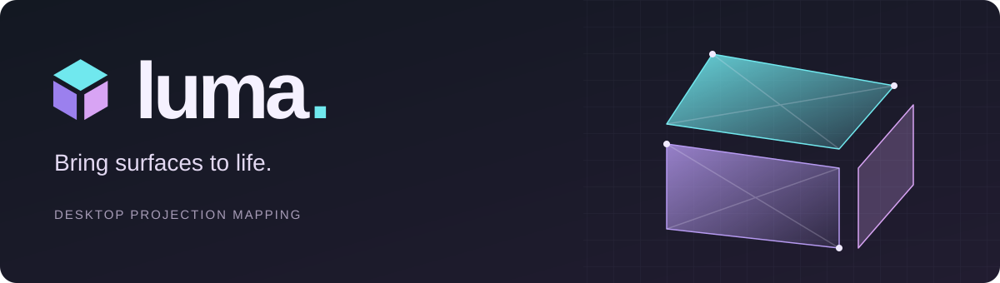

# Luma Projection Studio



**Bring surfaces to life.** A Windows desktop app for mapping animated light onto buildings, props and scenery with one projector. Draw and warp shapes, build linked stories, and react to music with **154 built-in effects and materials**.

Luma runs locally with no account or network connection. Built with Electron, React, TypeScript, Canvas 2D and WebGL.

## Download and run

Get the Windows build from [GitHub Releases](https://github.com/aransmithson/luma-projection-studio/releases/latest). The repository and downloads are public.

- **Recommended:** download `Luma-Projection-Studio-1.16.0-win-x64.zip`, extract the whole folder, and open `Luma Projection Studio.exe`. Keep the executable beside its resources.
- **Portable:** download `Luma-Projection-Studio-1.16.0.exe`. It extracts before opening; allow that first launch to finish.
- Close an older running copy before opening a new version. Luma restores the existing instance when opened again.

Release builds are not code-signed. The Windows executable keeps Electron's original resources to preserve compatibility with Windows Code Integrity; Luma's own icon appears in the app window and interface.

## What it does

| Area | Features |
| --- | --- |
| Shape mapping | Rectangles, triangles, ellipses, polygons, Bezier curves, precise corner editing, perspective warping and editable cutout holes |
| Placement | Projected wireframe/mesh, visible placement cursor, snapping, pixel nudging, calibration and solo view |
| Compositing | Layers, copy/paste, ten blend modes, feathering, colour overlays and independent content rotation/offset |
| Effects | 142 animations and 12 still materials, including Halloween, Christmas, space, creatures, shadow puppets, architectural illusions and stage lighting |
| Imported animations | MP4/H.264 videos and animated GIFs, thumbnails, looping, trim, time offset, speed and fill/fit/stretch |
| Linked stories | Synchronized liquid stacks, character chases and portal journeys across two to eight shapes |
| Music | Six equaliser-style effects using computer audio, microphone/line-in or an explicit demo signal |
| Playback | Shared Play, Pause and Restart, plus immediate output blackout |
| Projects | `.luma` files, undo/redo, autosave and recovery of the previous valid save |

Projects support **32 surfaces**, **64 vertices per polygon**, and **eight animation stacks**. The stacked editor keeps settings and Save visible in a wide three-column layout.


## Your first projection

1. Connect a projector and choose **Extend these displays** in Windows.
2. Open **Launch output**, select the projector and match its resolution.
3. Add shapes, then use **Placement mesh** to align their outlines with the real surfaces.
4. Apply effects or open an [example project](examples/). Use **Stacked animations** to link shapes.
5. Save your project and play. **B** blacks out the projection; **M** switches mesh mode. In output, **F** toggles fullscreen and **Esc** closes it.

For music effects, choose **Music input**, select a source and press **Start audio**. Listening never starts automatically. Audio is analysed locally without recording or uploading it.

Read the [user guide](docs/USER_GUIDE.md) for the complete effects catalogue, linked animations, geometry and recovery behaviour.

## Import your own animations

Select a shape, click **Import animation** in the effects library, then choose an **MP4 video** or **animated GIF**. The imported animation is applied to the selected editable shape and stays available in the **Imported** collection. Use the **Effect** inspector for fit, trim, looping, speed and time offset. Existing rotation, offsets, holes, overlays and blend modes work with imported clips.

**Recommended:** 1080p H.264 MP4 at 24 or 30 fps for full scenes; small GIFs for transparent characters or short loops. Video sound is muted. All clips follow the shared Play, Pause and Restart controls.

Luma copies imports into its local library. Saving a project copies the assets it uses into a companion folder, for example `House.luma.media` beside `House.luma`. **Move or share both together.** If an animation is missing, use **Effect → Locate original**. See the [media guide](docs/USER_GUIDE.md#import-animations) for limits and playback details.

## Run from source

Use Windows and **Node.js 24**. Installing dependencies needs internet access to download Electron; running the built app does not.

```powershell
git clone https://github.com/aransmithson/luma-projection-studio.git
cd luma-projection-studio
npm ci
npm run dev
```

To run a production build locally:

```powershell
npm run build
npm start
```

After building, [Start Luma.cmd](Start%20Luma.cmd) is also a double-click launcher. `npm run dev:web` provides a browser preview; native display selection, file dialogs and desktop audio behaviour require Electron.

## Current scope

Luma supports one projector. The desktop app imports MP4 video and GIF animations. WebM, MOV, standalone images and After Effects projects are not supported. Project Open accepts `.luma` and compatible project JSON files; use **Import animation** for media. Browser preview cannot import or access the desktop media library.

Timelines, BPM/timecode sync, multi-projector edge blending and automatic camera calibration are also outside the current release.

## Documentation

- [User guide and full effects catalogue](docs/USER_GUIDE.md)
- [Changelog](CHANGELOG.md)
- [Development, testing and packaging](CONTRIBUTING.md)
- [Repository instructions for coding agents](AGENTS.md)
- [Security and data handling](SECURITY.md)

## Licence

This public project retains its existing **UNLICENSED** status. Public visibility does not grant an open-source licence. Third-party dependencies retain their own licences. Example scenes use locally generated artwork; no stock footage is bundled.
