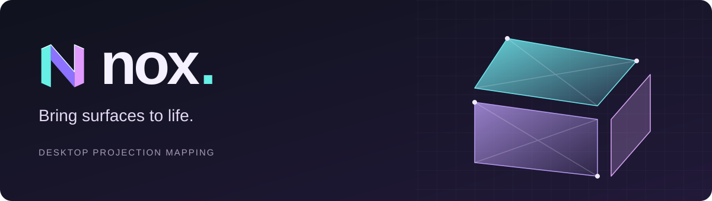
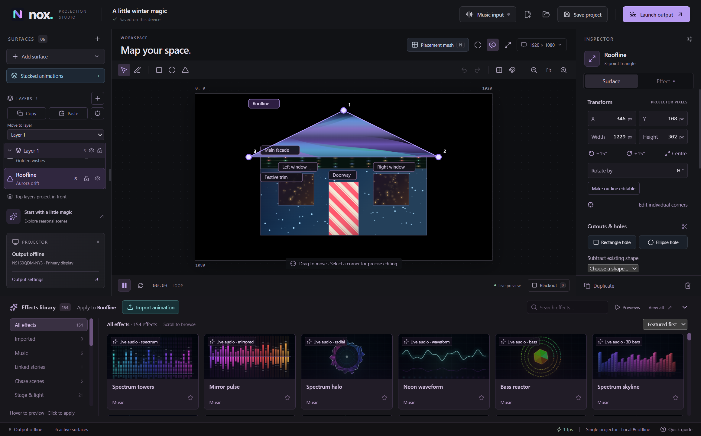
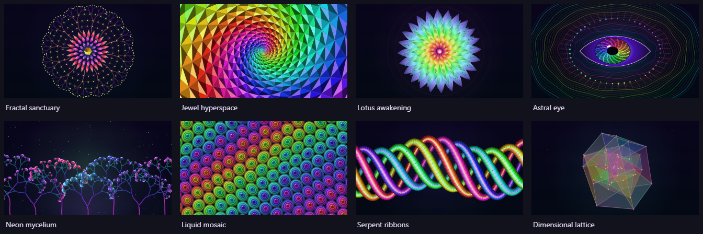
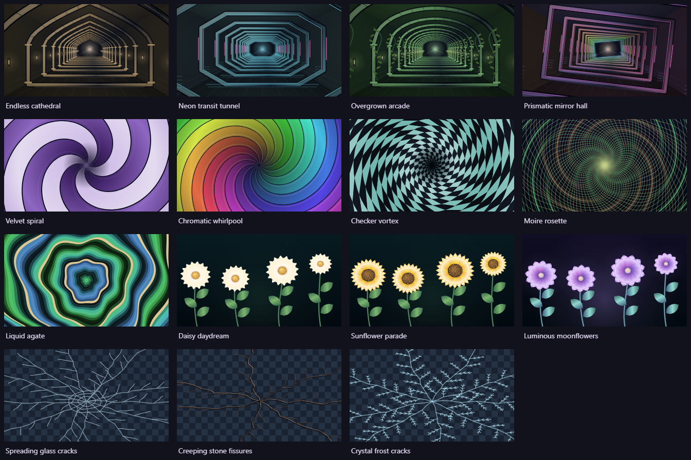
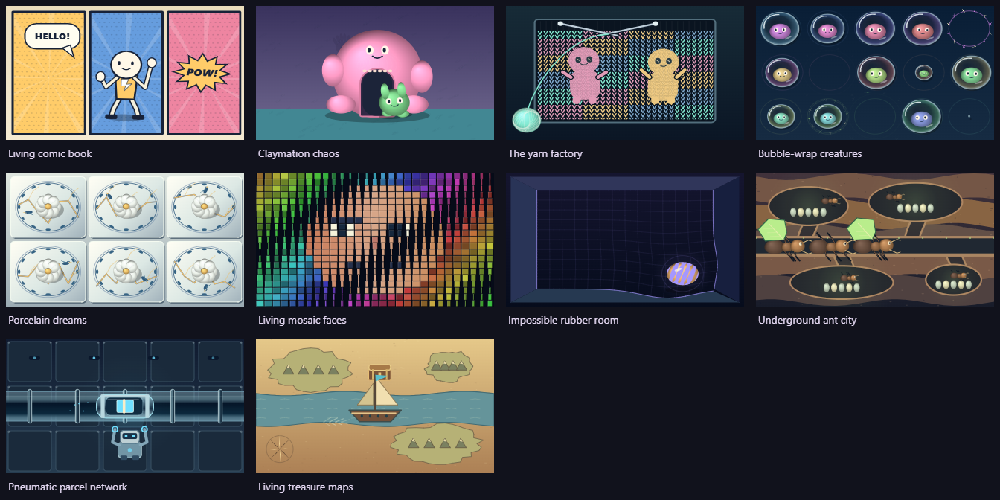
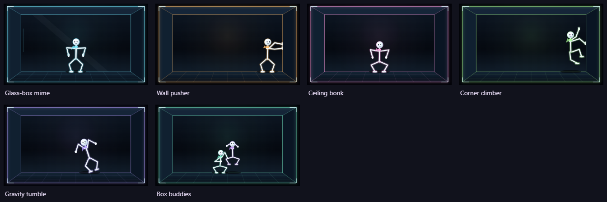
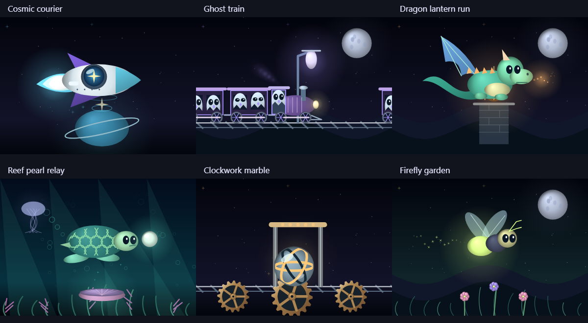

# Nox Projection Studio



**Bring surfaces to life.** A Windows desktop app for mapping animated light onto buildings, props and scenery with one projector. Draw and warp shapes, build linked stories, and react to music with **199 built-in effects and materials**.

Mapping, effects and imported playback run locally with no account. Optional **Scene Animator** generation connects your scene photo and prompt to Runway; it needs internet access and your own paid Runway API account. Built with Electron, React, TypeScript, Canvas 2D and WebGL.

Previously called **Luma**. Your existing `.luma` projects, imported library, preferences and recovery data continue to work. The new name does not require a profile or project migration.

## Download and run

Get the Windows build from [GitHub Releases](https://github.com/aransmithson/nox-projection-studio/releases/latest). The repository and downloads are public.

- **Recommended:** download `Nox-Projection-Studio-1.23.0-win-x64.zip`, extract the whole folder, and open `Nox Projection Studio.exe`. Keep the executable beside its resources.
- Close an older running copy before opening a new version. Nox restores the existing instance when opened again.

Version 1.23.0 uses the verified ZIP distribution. Its extracted editor passed native Windows startup checks. The separate single-file launcher is omitted following a Windows Code Integrity block during the 1.22.0 release checks.

Release builds are not code-signed. The Windows executable keeps Electron's original resources to preserve compatibility with Windows Code Integrity; Nox's own icon appears in the app window and interface.

## What it does

| Area | Features |
| --- | --- |
| Shape mapping | Rectangles, triangles, ellipses, polygons, Bezier curves, precise corner editing, perspective warping and editable cutout holes |
| Placement | Projected wireframe/mesh, visible placement cursor, snapping, pixel nudging, calibration and solo view |
| Workspace | Independently hide or restore Effects and Properties panels; your layout is remembered on this device |
| Compositing | Layers, copy/paste, ten blend modes, feathering, colour overlays and independent content rotation/offset |
| Effects | 187 animations and 12 still materials, including psychedelia, boxed stick figures, Halloween, Christmas, space, creatures, shadow puppets, architectural illusions and stage lighting |
| Imported animations | MP4/H.264 videos and animated GIFs, thumbnails, looping, trim, time offset, speed and fill/fit/stretch |
| Scene Animator | JPG/PNG reference alignment, optional Runway generation, independent preview and one shared clip across selected props |
| Linked stories | Nine travelling stories with local reactions, plus synchronized liquid stacks, character chases and portal journeys across two to eight shapes |
| Music | Six equaliser-style effects using computer audio, microphone/line-in or an explicit demo signal |
| Playback | Shared Play, Pause and Restart, plus immediate output blackout |
| Projects | `.luma` files, undo/redo, autosave and recovery of the previous valid save |

Projects support **32 surfaces**, **64 vertices per polygon**, and **eight animation stacks**. The stacked editor keeps settings and Save visible in a wide three-column layout.



## Psychedelic visions

Eight DMT-inspired animations have their own **Psychedelic** collection: **Fractal sanctuary**, **Jewel hyperspace**, **Lotus awakening**, **Astral eye**, **Neon mycelium**, **Liquid mosaic**, **Serpent ribbons** and **Dimensional lattice**. They combine recursive filigree, bevelled gems, breathing petals, an iridescent iris, glowing organic branches, liquid stained glass, woven scales and rotating four-dimensional geometry.



Select a shape and choose **Psychedelic**, or search **DMT** in **All effects**. Each animation loops every 24 seconds at normal speed and supports **Speed**, **Pattern scale**, **Accent colour**, optional colour cycling, **Shuffle variation** and the shared playback controls. Open the [Psychedelic gallery](examples/Psychedelic-collection.luma) to try all eight together. Everything is drawn locally; no footage downloads or AI service are required.

## Endless corridors, hypnotic swirls, flowers and cracks

Fifteen new **Dreamscape** effects add four endless corridors in **3D illusions**, five swirling patterns in **Hypnotic**, three sprouting flower scenes in **Nature** and three transparent cracks in **Overlays**. Choose **All effects** and search **dreamscape** to see the collection together.



The corridors travel through a pointed cathedral, neon transit tunnel, overgrown arcade and prismatic mirror hall. The hypnotic set includes a velvet spiral, rainbow whirlpool, checker vortex, moire rosette and liquid agate. Daisies, sunflowers and luminous moonflowers sprout, open and retreat on repeating loops.

**Glass**, **stone** and **frost** cracks grow across a transparent background, hold, then disappear. Duplicate an existing shape, apply a crack effect to the upper copy and leave its blend mode on **Normal**. The original animation remains visible beneath the cracks. The checkerboard in the effect thumbnail indicates transparency; it is never projected. Use opacity, colour, pattern scale and content transforms to adjust the overlay.

Open [Dreamscape collection](examples/Dreamscape-collection.luma) for all fifteen, or [Transparent cracks](examples/Transparent-cracks.luma) for three ready-layered examples. These effects follow shared Play, Pause and Restart, run locally and add no objects when applied.

## Imagination animation styles

The **Imagination** collection adds **Living comic book**, **Claymation chaos**, **The yarn factory**, **Bubble-wrap creatures**, **Porcelain dreams**, **Living mosaic faces** and **Impossible rubber room**. Each has its own artwork, materials and repeating action.

Three more styles are in **Linked stories**: **Underground ant city**, **Pneumatic parcel network** and **Living treasure maps**. Use them on one shape, or link two to eight shapes so ants, capsules and a sailing ship travel between your props. Their chambers, robots and treasure chests react to the shared arrival clock.



Choose **All effects** and search **creative** to see all ten together. Open the [Imagination collection example](examples/Imagination-collection.luma) for a ready-made gallery. Speed, scale, colour, overlays, Pause and Restart use the existing controls. These effects are generated locally and need no downloads or AI service.

## Stick figures trapped in boxes

Six animated escape attempts have their own **Stick figures** collection: **Glass-box mime**, **Wall pusher**, **Ceiling bonk**, **Corner climber**, **Gravity tumble** and **Box buddies**. Each has a recessed box, articulated figures, expressive faces and a repeating 12-second routine at normal speed.

Select a shape, choose an effect, then adjust **Figure size**, **Speed** and **Accent colour** in the Effect inspector. Figure size changes the characters while keeping the box frame in place. **Shuffle variation** changes the routine's starting phase; Play, Pause and Restart use the shared clock.



Open [Boxed stick figures](examples/Boxed-stick-figures.luma) to try all six together, or apply them to your existing shapes.

## Animate a photo of your props

Open **Scene Animator**, import a JPG or PNG photo taken near the projector lens, and align its four corners. Use the main editor to outline and name your props. The reference can appear in the editor and, through a separate toggle, on the projector.

The reference photo appears in the object list above the layers. Select it to drag it on the canvas, adjust its corners, position, size and opacity, or hide/remove it. It remains an alignment guide; applied animations keep their saved alignment until reapplied.

In **Create animation**, enter a prompt, add your Runway API key for this session, and explicitly enable sending the photo to Runway. Generate a five- or ten-second variation, then preview it with the exact shape masks before applying. Alternatively, use **Preview & apply** to import an externally generated MP4 or GIF without connecting an AI service.

One clip spans the selected shapes, so each prop reveals the appropriate part of the scene. Holes, layers and blending remain available, and applied clips use the shared playback clock. AI camera stability and seamless loops are not guaranteed: inspect the preview and trim the loop before use. This is manual photo alignment, not automatic 3D reconstruction or projector calibration. See the [Scene Animator guide](docs/USER_GUIDE.md#scene-animator).

## New linked stories

Send a star-carrying rocket, a ghost train, an emerald dragon, a pearl-guiding turtle, a clockwork marble, a glowing firefly, leaf-carrying ants, a parcel capsule or a sailing ship through your mapped shapes. Each tile reacts as its traveller passes, and the last tile leads back to the first.

Open **Stacked animations → Linked stories**, choose a **Story theme**, then **Create linked story** for three ready-to-place shapes. To use existing shapes, apply a story from the effects library and choose **Effect → Link this story across shapes**. Set the route order, direction, size, colour and loop duration together. All tiles share Play, Pause and Restart.



See the [linked-story guide and examples](docs/USER_GUIDE.md#create-a-linked-story) for ready-made projects and placement tips.

For liquid loops, open **Stacked animations → Liquid flow**, choose a style, tick two to eight existing shapes, arrange their flow order and click **Apply to selected shapes**. **Add 3 demo shapes** is a separate optional example.

## Your first projection

1. Connect a projector and choose **Extend these displays** in Windows.
2. Open **Launch output**, select the projector and match its resolution.
3. Add shapes, then use **Placement mesh** to align their outlines with the real surfaces.
4. Apply effects or open an [example project](examples/). Use **Stacked animations** to link shapes.
5. Save your project and play. **B** blacks out the projection; **M** switches mesh mode. In output, **F** toggles fullscreen and **Esc** closes it.

For music effects, choose **Music input**, select a source and press **Start audio**. Listening never starts automatically. Audio is analysed locally without recording or uploading it.

Read the [user guide](docs/USER_GUIDE.md) for the complete effects catalogue, linked animations, geometry and recovery behaviour.

## Import your own animations

Select a shape, click **Import animation** in the effects library, then choose an **MP4 video** or **animated GIF**. The imported animation is applied to the selected editable shape and stays available in the **Imported** collection. Use the **Effect** inspector for fit, trim, looping, speed and time offset. Existing rotation, offsets, holes, overlays and blend modes work with imported clips.

**Recommended:** 1080p H.264 MP4 at 24 or 30 fps for full scenes; small GIFs for transparent characters or short loops. Video sound is muted. All clips follow the shared Play, Pause and Restart controls.

Nox copies imports into its local library. Saving a project copies the assets it uses into a companion folder, for example `House.luma.media` beside `House.luma`. **Move or share both together.** If an animation is missing, use **Effect → Locate original**. See the [media guide](docs/USER_GUIDE.md#import-animations) for limits and playback details.

## Run from source

Use Windows and **Node.js 24**. Installing dependencies needs internet access to download Electron. Mapping and playback work offline; optional AI generation needs a connection.

```powershell
git clone https://github.com/aransmithson/nox-projection-studio.git
cd nox-projection-studio
npm ci
npm run dev
```

To run a production build locally:

```powershell
npm run build
npm start
```

After building, [Start Nox.cmd](Start%20Nox.cmd) is also a double-click launcher. `npm run dev:web` provides a browser preview; native display selection, file dialogs and desktop audio behaviour require Electron.

## Current scope

Nox supports one projector. The desktop app imports MP4 video and GIF animations, plus JPG/PNG reference photos in Scene Animator. WebM, MOV, still-image effects and After Effects projects are not supported. Project Open accepts `.luma` and compatible project JSON files; use **Import animation** for clips. Browser preview cannot import or access the desktop media library or generate scenes.

Timelines, BPM/timecode sync, multi-projector edge blending and automatic camera calibration are also outside the current release.

## Documentation

- [User guide and full effects catalogue](docs/USER_GUIDE.md)
- [Changelog](CHANGELOG.md)
- [Development, testing and packaging](CONTRIBUTING.md)
- [Repository instructions for coding agents](AGENTS.md)
- [Security and data handling](SECURITY.md)

## Licence

This public project retains its existing **UNLICENSED** status. Public visibility does not grant an open-source licence. Third-party dependencies retain their own licences. Example scenes use locally generated artwork; no stock footage is bundled.
